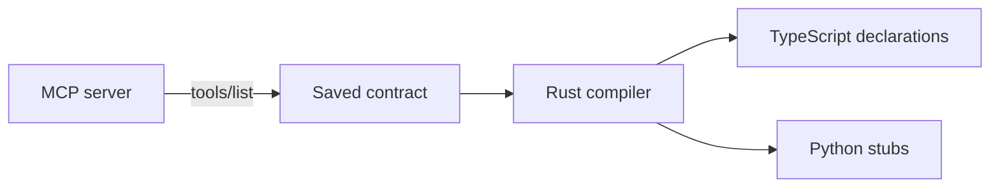

# mcptype

A Rust library and CLI that turns MCP tool schemas into TypeScript and Python contracts. Clients use the official MCP SDKs and import `mcp`.

## Install

Source preview: `0.0.1`. Registry packages have not been published. Building from source requires Rust, Node 22+, and Python 3.11+.

```sh
git clone https://github.com/hughhan1/mcptype.git
cd mcptype
cargo build --locked --release
npm ci
uv sync --extra test
```

Use `target/release/mcptype` for the CLI commands below, or put it on `PATH`.

## CLI

### Register a server

```sh
mcptype add docs http https://example.com/mcp
mcptype add files stdio python ./server.py
```

Connects, lists tools, and writes `mcptype.lock.json`, `mcptype-env.d.ts`, and `typings/mcptype/__init__.pyi`. Repeating `add` refreshes the saved contract. Discovery does not call tools. HTTP discovery currently supports unauthenticated servers; clients accept authentication headers at runtime.



### Editor and CI

Include `mcptype-env.d.ts` in the project's TypeScript compilation. Python projects configure their existing checkers:

```toml
[tool.pyright]
stubPath = "typings"

[tool.mypy]
mypy_path = "$MYPY_CONFIG_FILE_DIR/typings"
```

Commit the lock and declarations. No editor extension or dev-command wrapper is required.

```sh
mcptype check
npx tsc --noEmit
# Or:
uv run mypy src
```

`mcptype check` verifies declarations against the saved contract without network access or writes. `mcptype generate` regenerates them offline. Neither command proves that a remote server is unchanged.

## TypeScript

```ts
import { mcp } from "mcptype";

const files = await mcp("files");
try {
  const result = await files.tools.read_text_file({ path: "README.md" });
  console.log(result.content);
} finally {
  await files.close();
}
```

## Python

```python
from mcptype import mcp

async with mcp("files") as files:
    result = await files.tools.read_text_file({"path": "README.md"})
    print(result["content"])
```

Both clients resolve names from the nearest `mcptype.lock.json` above the working directory. A `url` override changes the address while retaining the named contract. Stdio commands run from the lock's directory. Headers supplied to the client are not written to the lock.

## Rust API

```rust
use mcptype::{Catalog, Language, generate};
use std::collections::BTreeMap;

fn main() -> Result<(), mcptype::Error> {
    let catalog = Catalog::try_from(serde_json::json!({
        "tools": [{"name": "ping", "inputSchema": {"type": "object"}}]
    }))?;
    let contracts = BTreeMap::from([("server".into(), catalog)]);
    let declarations = generate(Language::TypeScript, &contracts);
    println!("{}", declarations.declarations);
    Ok(())
}
```

### Build tools

The compiler is a library call. Node-API and Python `abi3` bindings are included in the language packages; no `mcptype` executable is needed for compilation. Installing from source requires Rust.

```js
import { compile } from "mcptype/compiler";
const { declarations } = await compile({ language: "typescript", contracts });
```

```python
from mcptype.compiler import compile
result = compile({"language": "python", "contracts": contracts})
```

`contracts` maps binding names to MCP tool catalogs. Both bindings return `{ "declarations": "..." }` and raise an error for invalid contracts. They do not connect to servers or write files. Runtime clients do not load the compiler.

Go hosts link the static C library through `pkg-config: mcptype`:

```sh
python3 scripts/package-sdk.py /path/to/sdk aarch64-apple-darwin
export PKG_CONFIG_PATH=/path/to/sdk/lib/pkgconfig
```

The C ABI uses an owned request: `mcptype_request_create` copies input JSON; `mcptype_compile` returns borrowed output valid until the next compile or `mcptype_request_free`. One compilation per request may run at a time. `mcptype_request_cancel` may run concurrently; cancellation is cooperative during schema parsing. Wait for compilation and cancellation calls to finish before freeing. Responses distinguish success, invalid requests, and cancellation. The CLI retains `mcptype compile` for shell callers.

## Contracts

- The saved MCP schemas define inputs and outputs. Types never come from sampled tool results. Unknown bindings are type errors until registered.
- Both clients validate inputs and successful structured outputs against those saved schemas. Server drift cannot silently redefine the caller's types.
- `.tools` returns structured output and throws `ToolCallError` for tool errors or input-required results. `callTool` / `call_tool` returns the full MCP result, including text, media, errors, and input requests supported by the negotiated protocol. Unusual or reserved tool names remain accessible through this raw method.
- Missing output schemas produce TypeScript `unknown` or Python `object`. Objects, arrays, scalar literals, unions, local references, and named definitions are supported. Recursive references and unsupported shapes lose static detail; runtime schema validation remains authoritative. Python represents JSON arrays as lists, including tuple schemas.
- Registration is explicit. Imports do not contact servers, execute local commands, refresh contracts, or modify files. No hosting service or package registry is required after installation.

## Go declarations

Compile with `language: "go"` through the existing compiler API. The result has
Go declarations (without a package clause) and a `bindings` map containing each
binding's client name and each tool's generated method, input, and output names.
Hosts can use these symbols to generate transport-specific clients without
reimplementing name allocation. Names are deterministic and collision-safe.

Closed objects produce structs, arrays produce slices, and homogeneous maps
retain their value type. JSON numbers use `json.Number` to preserve precision.
Optional fields retain presence; nullable and unsupported shapes use
`json.RawMessage`. Open objects with named fields use raw-message maps so unknown
properties survive round trips. Named definitions are emitted separately.
Runtime schema validation remains the caller's responsibility. This compiler
adds no Go transport or Holon-specific runtime.
